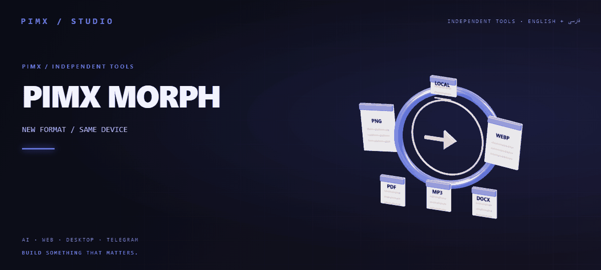
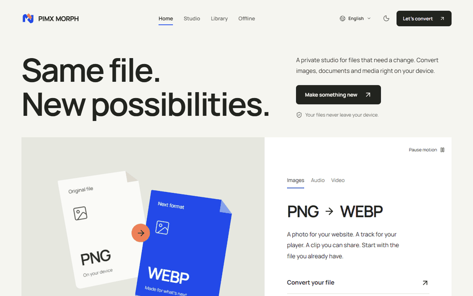

<div align="center">

<a href="https://pimxmorph.pages.dev/"></a>

[English](README.md) · [فارسی](README.fa.md) · [Live website ↗](https://pimxmorph.pages.dev/)

[](https://github.com/MOHAMMADREZAABEDINPOOR/PIMX_MORPH)

</div>

# PIMX MORPH

تصویر، PDF، سند، صدا، ویدئو و داده‌های ساختاریافته را روی دستگاه خودت تبدیل کن. ابتدا فایل را انتخاب کن تا خروجی‌های سازگار نمایش داده شوند؛ نتیجه‌ها را در کتابخانهٔ مرورگر نگه دار و برنامه را با ابزارهای دانلودشده آفلاین استفاده کن.

<a href="https://pimxmorph.pages.dev/"></a>

[پیش‌نمایش رابط بازطراحی‌شده · PNG](assets/readme/redesign.png) · [Static artwork](assets/readme/hero.png)

## امکانات

- انتخاب فایل پیش از نمایش فرمت‌های خروجی سازگار
- ابزارهای محلی تصویر و HEIC، PDF، DOCX، رسانه و JSON/CSV
- کتابخانهٔ ماندگار خروجی‌ها، PWA نصب‌شدنی و موتور رسانهٔ قابل دانلود برای آفلاین

## انتخاب، تبدیل و نگهداری

از `/` وارد `/upload` شو و فایل‌ها را انتخاب کن. MORPH بعد از آن فرمت‌های خروجی سازگار را نشان می‌دهد. نتیجه را دانلود کن یا بعداً از `/library` به آن برگرد؛ خروجی‌ها به‌صورت محلی ذخیره می‌شوند و امکان دانلود دوباره و حذف دارند. صفحهٔ `/offline` وضعیت واقعی ابزارهای ذخیره‌شده روی دستگاه را نشان می‌دهد.

نشان M تاخورده، تصویر سه‌بعدی متحرک، رابط فارسی و انگلیسی و پوسته‌های روشن و تاریک کنار موتورهای تبدیل محلی قرار دارند. محتوای فایل برای تبدیل آپلود نمی‌شود و حساب کاربری یا کلید API هوش مصنوعی لازم نیست.

## فرمت‌ها و محدودیت‌ها

ابزارهای تصویر و HEIC، ادغام و تقسیم و رندر PDF، متن سندها، تبدیل صدا و ویدئو و JSON/CSV هرکدام ورودی و خروجی مشخصی دارند. تبدیل PDF به Word متن موجود را بازسازی می‌کند و ممکن است چیدمان را حفظ نکند. متن اسکن‌شده به ابزار OCR جداگانه نیاز دارد. حافظهٔ مرورگر و کدک‌های همراه برنامه بر تبدیل رسانه محدودیت می‌گذارند.

## نصب و استفادهٔ آفلاین

نسخهٔ نهایی را آنلاین باز کن و منتظر تأیید آمادگی ابزارهای آفلاین بمان. پیش از قطع اینترنت، ابزارهای بزرگ‌تر رسانه را جداگانه ذخیره کن. کش ابزارها و خروجی‌های کتابخانه در فضای ذخیره‌سازی مرورگر نگه‌داری می‌شوند؛ پاک‌کردن داده‌های سایت می‌تواند هر دو را حذف کند. فایل‌های مهم را بیرون مرورگر هم نگه دار. نصب به پشتیبانی مرورگر بستگی دارد.

جزئیات کش، نصب، مجوز موتورها و به‌روزرسانی در [OFFLINE.md](OFFLINE.md) آمده است.

## اجرای محلی

Node.js نسخهٔ 22.12 یا جدیدتر لازم است.

```sh
npm ci
npm run dev
```

| فرمان | کاربرد |
| --- | --- |
| `npm run lint` | بررسی TypeScript |
| `npm run build` | آماده‌سازی موتورهای محلی، ساخت و پیش‌رندر مسیرها |
| `npm run preview` | پیش‌نمایش PWA نهایی |
| `npm run test:e2e` | آزمون مرورگر، فرمت و تبدیل آفلاین |

پوشهٔ `dist` را روی میزبان استاتیک HTTPS منتشر کنید. برای Cloudflare Pages فایل‌های `_headers` و `_redirects` را حفظ کنید. موتورهای تبدیل با `predev` و `prebuild` از وابستگی‌های npm آماده می‌شوند. آمار اختیاری بازدید در `functions/` مستقل از پردازش فایل است.

[کد مبدل‌ها](src/) · [اسکریپت‌های ساخت](scripts/) · [راهنمای آفلاین](OFFLINE.md)

[GitHub](https://github.com/MOHAMMADREZAABEDINPOOR/PIMX_MORPH) · [PIMX](https://github.com/MOHAMMADREZAABEDINPOOR) · [Portfolio](https://pimx.pages.dev/)
